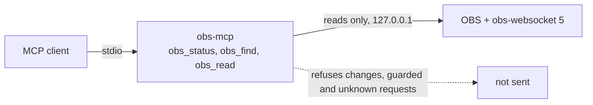

# obs-mcp

**obs-mcp is a local MCP server that gives an AI agent safe read access to OBS Studio, through obs-websocket, on any machine.**

An agent can find any of the 147 documented obs-websocket requests and run the reads. A read can never change OBS, stop a recording or send a request that is known to crash OBS.

[](https://github.com/erickb336/obs-mcp/actions/workflows/ci.yml) [](LICENSE)

> **Status: pre-release 0.0. Not yet published to npm. Not tested on real OBS**, except the one cleared list row in [Safety rules](#safety-rules). All tests run against a simulated OBS.

Contents: [Quick start](#quick-start) · [Usage](#usage) · [Tools](#tools) · [Safety rules](#safety-rules) · [How it works](#how-it-works) · [Settings](#settings) · [Under the hood](#under-the-hood) · [Licence](#licence)



## Quick start

You need Node 22 or newer, and OBS Studio 30 or newer (obs-websocket 5 is part of OBS).

> **Not yet published.** The `npx` commands below work after the first npm release. Until then, use [Under the hood](#under-the-hood) to run it from a clone.

1. Check your machine. The doctor only reads, and it tells you what to fix:

   ```sh
   npx -y @erickb336/obs-mcp doctor
   ```

2. In OBS, turn on the server: Tools, WebSocket Server Settings, Enable WebSocket server. Read [the listener warning](#safety-rules) first.

3. Add the server to your MCP client. For Claude Code:

   ```sh
   claude mcp add --transport stdio obs -- npx -y @erickb336/obs-mcp
   ```

   For another client, the doctor prints the line or the JSON block to use.

## Usage

Ask your agent in plain words. Examples:

| You ask | The agent calls | You get |
| --- | --- | --- |
| "Is OBS recording?" | `obs_status` | Connection, versions, recording and stream state, scene, profile, listener exposure |
| "What is the volume of my mic?" | `obs_find` "input volume", then `obs_read` `GetInputVolume` | The fader value of that input |
| "Show me the scene list" | `obs_read` `GetSceneList` | The scenes and the current program scene |
| "Stop the recording" | `obs_find` shows `StopRecord` as guarded | A refusal. 0.0 never sends it. |

With OBS closed, `obs_status` answers with the problem and the next step, for example: "No answer from OBS on 127.0.0.1:4455. OBS is closed, its WebSocket server is off, or it uses another port."

## Tools

The list has 3 tools. Its size is about 385 tokens (method: compact JSON of `tools/list`, counted with cl100k_base through js-tiktoken 1.0.21, an approximation; target: 1,200 or fewer; a test checks it).

| Tool | What it does | Effect |
| --- | --- | --- |
| `obs_status` | Connection, OBS and obs-websocket versions, recording and stream state, scene, profile, scene collection, listener exposure, and live requests with no catalogue row. Works with OBS closed. | Read |
| `obs_find` | Searches the catalogue of 147 documented requests by words. Returns exact names, the effect, the fields, and whether `obs_read` runs each one. | Read |
| `obs_read` | Runs one read request. Checks the fields first. | Read |

What `obs_read` runs in 0.0, from the class table in [`catalogue/classes.json`](catalogue/classes.json):

| Class | Requests | In 0.0 |
| --- | --- | --- |
| read | 57 | Runs. `GetSourceScreenshot` saves the image to a file in a folder that the server makes in the system temporary folder; the reply gives only the path and the size. `GetPersistentData` passes a number, a boolean or null; any other slot value becomes `[redacted]`. |
| change | 56 | Refused, not sent |
| guarded | 34 | Refused, not sent, except three reads with their own guard: `GetInputPropertiesListPropertyItems`, `GetStreamServiceSettings` and `GetProfileParameter` (only video, audio, output mode and recording parameters; never tokens or output URLs) |
| not documented | 4 private-settings requests that OBS offers live | Refused, not sent |

`SaveSourceScreenshot` is a change, so it is refused in 0.0.

## Safety rules

- **The server never stops a recording unless you ask.** In 0.0 it sends no change at all: no start, no stop, no setting.
- **Listener exposure.** When the obs-websocket server is on, OBS listens on all network interfaces. It has no option to listen on localhost only. Other devices on your network can reach it, unless a firewall blocks them. Keep a password set. `obs_status` and the doctor report what listens on the port.
- **obs-mcp opens no port.** It speaks MCP over stdio only, and it connects to OBS on 127.0.0.1 only.
- **The password** comes from the obs-websocket settings file, or from `OBS_WEBSOCKET_PASSWORD`. Never give it as an argument: OBS writes its own command line to its log. No reply, log or doctor line shows it.
- **Secrets in replies.** Values with a secret name (password, key, token) become `[redacted]`. A URL keeps only its scheme and host, because a path or query can hold a stream key (for example `rtmp://host/app/<key>` or `srt://host?streamid=<key>`). `GetStreamServiceSettings` passes only `service`, `server` and `protocol`.
- **List requests can crash OBS.** `GetInputPropertiesListPropertyItems` runs only on a row that was tested on real OBS. Today there is one row: property `type` of a `screen_capture` input, on macOS, OBS 33.0.1. Before each list request the server reads the recording state; during any recording, whoever started it, the request is refused.
- **The doctor changes nothing.** It reads files and asks the OS. It notes a leftover crash file in the OBS `.sentinel` folder and never deletes it.

## How it works

- A generator builds the catalogue from a pinned [`protocol.json`](protocol/SOURCE.md) of obs-websocket 5.7.6 and the class table. The build fails when a request has no row in the table.
- At connect, the server reads `GetVersion` and reports live requests that are not in the catalogue. It refuses them.
- All OS-specific code (settings folder, OBS discovery, listener reading) is in [`src/platform.ts`](src/platform.ts). The OBS layer has none.

## Settings

All are optional.

| Variable | Use |
| --- | --- |
| `OBS_WEBSOCKET_PASSWORD` | The password, in place of the one in the obs-websocket settings file |
| `OBS_WEBSOCKET_PORT` | The port, in place of the one in the settings file (default 4455) |
| `OBS_STUDIO_CONFIG_DIR` | The OBS settings folder, for a portable or custom install |

## Under the hood

| Folder | Holds |
| --- | --- |
| `src/` | The server, the doctor, the OBS layer and the platform layer |
| `catalogue/classes.json` | One class row for each documented request |
| `protocol/` | The pinned protocol description and its source |
| `scripts/` | The catalogue generator and the packed-package smoke test |
| `test/` | Tests, and a simulated OBS that closes the socket (code 1006) on an untested list request |

Run the checks from a clone:

```sh
npm ci
```

```sh
npm test
```

```sh
npm run smoke
```

`npm test` builds, then runs the tests. `npm run smoke` packs the package, starts it with `npx` from the tarball, and drives it with an MCP client. CI runs both on Linux, macOS and Windows.

To run the server from a clone, point your client at `node <clone>/dist/cli.js` after `npm test`.

## Credits

- [obs-websocket](https://github.com/obsproject/obs-websocket): the protocol description in `protocol/`.
- [obs-websocket-js](https://github.com/obs-websocket-community-projects/obs-websocket-js) (MIT) and the [MCP TypeScript SDK](https://github.com/modelcontextprotocol/typescript-sdk) (MIT).

## Consent to record

A person may need the consent of the others before recording them. The rules depend on the place. This is not legal advice.

## Licence

[MIT](LICENSE)
