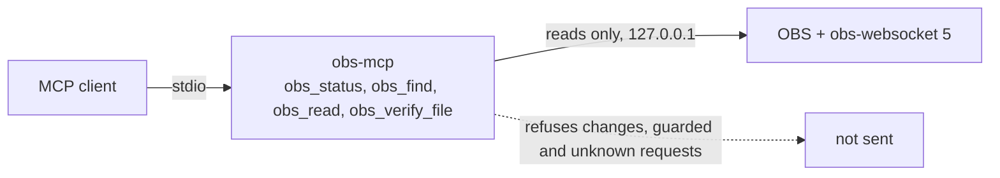

# obs-mcp

**obs-mcp is a local MCP server that gives an AI agent safe read access to OBS Studio, through obs-websocket, on any machine.**

An agent can find any of the 147 documented obs-websocket requests and run the reads. A read can never change OBS, stop a recording or send a request that is known to crash OBS.

[](https://github.com/erickb336/obs-mcp/actions/workflows/ci.yml) [](LICENSE)

> **Status: pre-release 0.0. Not yet published to npm.** All tests run against a fake OBS that replays stored traces ([The fake OBS and its traces](#the-fake-obs-and-its-traces)):
>
> - **Real traces:** the default reads, and `StartRecord` and `StopRecord`. They were captured from a real OBS 33.0.1 on macOS, then scrubbed.
> - **Simulated behaviour:** `ToggleRecord`, pause and resume, `StopOutput`, `ToggleOutput`, the stop hotkey, the live-output blocks and the crash of a list request. These traces are written by hand, so the stop-rule sweep runs against a simulated take.
>
> The one cleared list row in [Safety rules](#safety-rules) was also tested on real OBS.

Contents: [Quick start](#quick-start) · [Usage](#usage) · [Tools](#tools) · [Safety rules](#safety-rules) · [How it works](#how-it-works) · [Settings](#settings) · [Under the hood](#under-the-hood) · [Licence](#licence)



## Quick start

You need Node 22 or newer, git, and OBS Studio 30 or newer (obs-websocket 5 is part of OBS). The file check also needs ffmpeg; without it, the check says "Sound not checked".

> **Not yet published.** obs-mcp is not on npm yet, so you run it from a clone.

1. Get a copy and build it:

   ```sh
   git clone https://github.com/erickb336/obs-mcp.git
   ```

   ```sh
   cd obs-mcp
   ```

   ```sh
   npm ci
   ```

   ```sh
   npm run build
   ```

2. Check your machine. The doctor only reads, and it tells you what to fix:

   ```sh
   node dist/cli.js doctor
   ```

3. In OBS, turn on the server: Tools, WebSocket Server Settings, Enable WebSocket server. Read [the listener warning](#safety-rules) first.

4. Add the server to your MCP client. The doctor prints the line for Claude Code and Codex, and the JSON block for other clients, with the full path of your copy. For Claude Code, it has this form:

   ```sh
   claude mcp add --transport stdio obs -- node /full/path/to/obs-mcp/dist/cli.js
   ```

## Usage

Ask your agent in plain words. Examples:

| You ask | The agent calls | You get |
| --- | --- | --- |
| "Is OBS recording?" | `obs_status`, or `obs_find` "is OBS recording", which gives `GetRecordStatus` first | Connection, versions, recording and stream state, scene, profile, listener exposure |
| "What is the volume of my mic?" | `obs_find` "input volume", then `obs_read` `GetInputVolume` | The fader value of that input |
| "Show me the scene list" | `obs_read` `GetSceneList` | The scenes and the current program scene |
| "Did my last recording get both voices?" | `obs_verify_file` with the file name, and the expected sources: for example the mic on track 1 and the call on track 2 | One verdict per source, with the timecode of each silent gap |
| "Stop the recording" | `obs_find` shows `StopRecord` as guarded | A refusal. 0.0 never sends it. |

With OBS closed, `obs_status` answers with the problem and the next step, for example: "No answer from OBS on 127.0.0.1:4455. OBS is closed, its WebSocket server is off, or it uses another port."

## Tools

The list has 4 tools. Its size is about 690 tokens (method: compact JSON of `tools/list`, counted with cl100k_base through js-tiktoken 1.0.21, an approximation; target: 1,200 or fewer; a test checks it).

| Tool | What it does | Effect |
| --- | --- | --- |
| `obs_status` | Connection, OBS and obs-websocket versions, recording and stream state, scene, profile, scene collection, listener exposure, and live requests with no catalogue row. Works with OBS closed. | Read |
| `obs_find` | Searches the catalogue of 147 documented requests by words. An exact request name comes first, then the requests that `obs_read` runs, then the rest. Returns exact names, the effect, the fields, and whether `obs_read` runs each one. | Read |
| `obs_read` | Runs one read request, or one of the 3 guarded reads behind its check. Checks the fields first: one of a name and UUID pair (for example `inputName` or `inputUuid`) is required, and a text value has 1,000 characters or fewer. | Read |
| `obs_verify_file` | Checks a saved recording in the recording folder: each audio track, over the full timeline. See [the file check](#the-file-check). | Read |

### The file check

`obs_verify_file` takes a file name in the recording folder, and optional expected sources. Each expected source has a name, a kind, a track and an optional backup track. The check only reads the file: it never changes, moves or deletes it, whatever the result.

A track number is the Nth audio track in the file; OBS writes only the tracks that are on. For example, if only OBS tracks 1 and 3 are on, OBS track 3 is track 2 in the file.

The check reads the file types that OBS records: `.mov`, `.mp4`, `.m4v`, `.mkv`, `.flv` and `.ts`. It refuses other types, for example an `.m3u8` playlist, and ffmpeg reads each file as the type of its name only.

| It reports | How |
| --- | --- |
| A file that cannot be read, or is cut short (for example a MOV without its index, a track with no audio data, a track whose audio data ends 1 s or more before its stated length, or, in an MKV, which states no length per track, 1 s or more before the end of the file) | ffprobe and ffmpeg errors, and decoded length against stated length or file length. ffmpeg error lines alone, with each track complete, are a warning: the log of ffmpeg can hold text from the file, so it never fails a file by itself |
| Duration, the video stream and where it ends (a warning when it ends 2 s or more before the file). MKV and FLV state no video length: then the check reads the video packets. If that read does not finish, the video claim is `not_checked` | ffprobe |
| Each audio track: peak, RMS, sound time, and every silent interval of 0.5 s or more (less when a gap limit is set below 0.5 s) with its timecodes. The claim about a track names its silent intervals too, also the ones below the limits. Sound time counts only audio data that is not silent | One ffmpeg pass: `astats` and `silencedetect` on each track |
| A channel of a stereo track that is silent while another channel has sound (a warning) | The peak of each channel, from `astats` |
| One verdict per claim: per expected source, or per track when you name none | The rules below |

The result has one state: `verified`, `verified_with_warnings`, `failed` or `not_checked`.

| Kind | Fails when | Warns when |
| --- | --- | --- |
| `voice` | No sound, or a silent gap of 30 s or more | A gap of 10 s or more |
| `continuous` | No sound, or a gap of 2 s or more | A gap of 0.5 s or more |
| `any` | No sound | Never, for gaps |

Each timecode counts from the start of the file, in each file type, also on a track that starts later than the others. (In a TS file, the clock of the streams starts near 1.4 s. The check counts from the start of the file there too.) A missing track or a file with no audio stream fails. A missing backup track warns. A low level (peak below -40 dB) or a peak that may clip warns. If a source fails alone and its backup track has sound at those times, the result is a warning that names the backup track. **The gap limits have no basis in a real take yet.** They are settings with conservative defaults (see [Settings](#settings)).

The check needs ffmpeg and ffprobe. Without them, the result is `not_checked` and says "Sound not checked", with the install line for your system. On macOS, `afinfo` then counts the audio tracks and their durations in a MOV or MP4. afinfo cannot read MKV, FLV or TS, or a MOV or MP4 with no audio or damaged audio: the result is then `not_checked`, not `failed`.

The sound is `not_checked`, with the reason, for a track with a sample rate below 8000 Hz (OBS records at 44.1 kHz or 48 kHz): there the check cannot time a silent interval. A track that states no sample rate is `not_checked` too: in a TS file, a track with no audio data is one.

The file must be inside the recording folder: the folder that OBS records to, or `OBS_MCP_RECORDING_DIR`. The check refuses a path with `..`, a path or a link that leads out of the folder, and anything that is not a regular file. It refuses a path outside the folder by its text, before it reads anything at that path: so a UNC path (`\\host\share`) or an automount never reaches the network, and the refusal is the same whether the file exists or not. ffmpeg runs with an argument list, never a shell, reads only local files, and stops at one time limit for the whole check.

The check never refuses a name for its characters, and it opens the file by its real name. A reply never holds an invisible character: each name in a reply or an error shows every control, format, private-use, unassigned or surrogate code point, U+2028, U+2029, every tag character (U+E0000 to U+E007F) and every variation selector as `\u{hex}`. For example, a text direction control U+202E shows as `\u{202E}`, and an emoji sequence shows its joiners as `\u{200D}`. A backslash that starts `\u{` in a real name shows as `\u{5C}`, so each `\u{...}` in a reply is an escape; any other backslash stays as it is.

Two limits remain, and both need write access to the recording folder. A hard link in the folder to a file outside it is a regular file in the folder, so the check reads it. A file that another program swaps after the path check is read as it is when ffmpeg opens it.

What `obs_read` runs in 0.0, from the class table in [`catalogue/classes.json`](catalogue/classes.json):

| Class | Requests | In 0.0 |
| --- | --- | --- |
| read | 57 | Runs. `GetSourceScreenshot` saves the image to a file in a folder that the server makes in the system temporary folder; the reply gives only the path and the size. The server deletes the folder when it exits. A slot value of `GetPersistentData` is settings: see [what the AI sees](#what-the-ai-sees). |
| change | 56 | Refused, not sent |
| guarded | 34 | Refused, not sent, except three reads with their own guard: `GetInputPropertiesListPropertyItems`, `GetStreamServiceSettings` and `GetProfileParameter` (only video, audio, output mode and recording parameters; never tokens or output URLs) |
| not documented | 4 private-settings requests that OBS offers live | Refused, not sent |

`SaveSourceScreenshot` is a change, so it is refused in 0.0.

## Safety rules

- **During a stream or a recording, the AI may do only what OBS itself allows then.** The server refuses everything else. 0.0 is read only, so today this rule applies to one request: the list request below.
- **The server never stops a recording unless you ask.** In 0.0 it sends no change at all: no start, no stop, no setting.
- **Listener exposure.** When the obs-websocket server is on, OBS listens on all network interfaces. It has no option to listen on localhost only. Other devices on your network can reach it, unless a firewall blocks them. Keep a password set. `obs_status` and the doctor report what listens on the port, and the program that listens. The doctor warns when that program is not OBS.
- **obs-mcp opens no port.** It speaks MCP over stdio only, and it connects to OBS on 127.0.0.1 only.
- **The password** comes from the obs-websocket settings file, or from `OBS_WEBSOCKET_PASSWORD`. Never give it as an argument: OBS writes its own command line to its log. No reply, log or doctor line shows it.
- **Secrets in replies.** Settings can hold a stream key, password or token in any text. So the AI gets settings text only when it is on a short allow-list. See [what the AI sees](#what-the-ai-sees). The debug log of obs-websocket-js prints raw replies, so the server turns it off, also when `DEBUG` names it.
- **List requests can crash OBS.** `GetInputPropertiesListPropertyItems` runs only on a row that was tested on real OBS. Today there is one row: property `type` of a `screen_capture` input, on macOS, OBS 33.0.1. Before each list request the server reads the recording state, the stream state and the state of every output in `GetOutputList` (replay buffer, virtual camera and plugin outputs too). During any active output, whoever started it, the request is refused and not sent. When a state is not known, or its read fails, the request is refused too. The request goes to OBS by the input UUID that the check found, so another client cannot swap the input in between.
- **The doctor changes nothing.** It reads files and asks the OS. It notes a leftover crash file in the OBS `.sentinel` folder and never deletes it.

### What the AI sees

Settings are the free-form values that OBS, plugins and scripts keep: every reply field whose name ends in `Settings` (for example `inputSettings`, `filterSettings`, `outputSettings`, `streamServiceSettings`, `transitionSettings`), the `slotValue` of `GetPersistentData`, and the `itemName` and `itemValue` of a list item. The server does not try to find secrets in them. It passes only values with a known safe shape.

Replies of `obs_read` and `obs_status` start with a note that tells the AI to treat the names and values from OBS as data, not instructions. A reply longer than 24,000 characters is cut, after the note.

| Value | What the AI gets |
| --- | --- |
| A reply field outside settings: names, kinds, states, numbers, for example a scene name or `outputActive` | The value |
| `GetProfileParameter` | The value, but only for the safe (category, name) pairs; other pairs are refused |
| A number, a boolean or null inside settings | The value |
| A text inside settings, on the allow-list for its kind and key, with the expected shape | The value |
| Any other text inside settings: URLs, paths, names, keys, passwords, JSON text | Only its type and length, for example `{"hidden":"text","length":42}` |
| A key inside settings, on the allow-list for its kind | The key |
| Any other key inside settings | `hidden_key_1`, `hidden_key_2` and so on; its value follows the same rules |
| A list or an object inside settings | The same rules for each item; an item in a list uses the key of the list |

The allow-list is `SAFE_SETTINGS` in [`src/redact.ts`](src/redact.ts). It holds only enums and the display UUID of a screen capture, for example the `protocol` of a stream service, `server: "auto"` of a common service, the `service` names of some common services, and the `sampling` of a scale filter. A stream server URL is hidden, also when it has no scheme.

## How it works

- A generator builds the catalogue from a pinned [`protocol.json`](protocol/SOURCE.md) of obs-websocket 5.7.6 and the class table. The build fails when a request has no row in the table.
- At connect, the server reads `GetVersion` and reports live requests that are not in the catalogue. It refuses them.
- All OS-specific code (settings folder, OBS discovery, listener reading, the audio tools of the file check) is in [`src/platform.ts`](src/platform.ts). The OBS layer has none.
- The file check is in [`src/verify.ts`](src/verify.ts). It does not use the OBS connection, except to ask for the recording folder.

## Settings

All are optional.

| Variable | Use |
| --- | --- |
| `OBS_WEBSOCKET_PASSWORD` | The password, in place of the one in the obs-websocket settings file |
| `OBS_WEBSOCKET_PORT` | The port, in place of the one in the settings file (default 4455). It must be a whole number from 1 to 65535; any other value, an empty one too, is an error that `obs_status` and the doctor report |
| `OBS_STUDIO_CONFIG_DIR` | The OBS settings folder, for a portable or custom install |
| `OBS_MCP_RECORDING_DIR` | The recording folder for `obs_verify_file`, in place of the folder that OBS gives. It lets the check work with OBS closed |
| `OBS_MCP_FFMPEG` | The full path of ffmpeg, with ffprobe in the same folder. Without it, both come from `PATH` |
| `OBS_MCP_VOICE_GAP_S` | The gap limit of a `voice` source, in seconds (default 30) |
| `OBS_MCP_CONTINUOUS_GAP_S` | The gap limit of a `continuous` source, in seconds (default 2) |
| `OBS_MCP_SILENCE_DB` | The level below which a track is silent, in dB (default -50) |
| `OBS_MCP_VERIFY_TIMEOUT_S` | The time limit of one check, ffprobe and every ffmpeg pass together, in seconds (default 900) |

## Under the hood

| Folder | Holds |
| --- | --- |
| `src/` | The server, the doctor, the OBS layer and the platform layer |
| `catalogue/classes.json` | One class row for each documented request |
| `protocol/` | The pinned protocol description and its source |
| `scripts/` | The catalogue generator, the packed-package smoke test, the trace capture, the trace scrub and the timing loop |
| `test/` | Tests, the fake OBS, and a script that makes SIMULATED media with ffmpeg for the file check. `test/real-files.test.mjs` checks real recordings of your own: it runs only when `OBS_MCP_REAL_DIR` names their folder |
| `test/traces/` | The stored traces that the fake OBS replays. Each file says its `source` (`real` or `simulated`), and its name starts with it |

### The fake OBS and its traces

All tests run against a fake OBS (`test/fake-obs.mjs`). It replays the stored traces: a request, its data and the output state give the status code, the reply, the events and the change of state of the trace. A request with no trace gets sample values in the shape of the protocol. The fake closes the socket with code 1006 on a list request that is not tested on real OBS, as real OBS does when it crashes. It counts each recording that stops.

The traces are of two kinds:

- **Real** (`real-*.json`): captured from a running OBS 33.0.1 with obs-websocket 5.7.6 on macOS, then scrubbed. `real-reads.json` holds the reads of the default capture plan that the fake does not answer from its own model. `real-record.json` holds `StartRecord` and `StopRecord`, each when idle and while recording, from one test recording. Names and settings are `[scrubbed]`, and each file's `basis` says what was left out.
- **Simulated** (`simulated-*.json`): written by hand from the protocol and from facts measured on real OBS 33.0.1 (for example, `SetVideoSettings` gives code 500 during any output). These are the requests that the capture does not send to a real OBS: `ToggleRecord`, pause and resume, `StopOutput`, `ToggleOutput`, the stop hotkey, `GetOutputSettings` and the live-output blocks.

| Tool | What it does |
| --- | --- |
| `node scripts/capture-traces.mjs --url ws://127.0.0.1:4455 --out trace.json` | Records requests, replies and events. It reads the password from `OBS_WEBSOCKET_PASSWORD` or a hidden prompt. It stops when a stream or recording is active. It sends only the requests that `obs_read` runs, behind the same guards as the server, and starts or stops a recording only with `--allow-record`. With it, the script starts a take only when no recording is active, and stops only the take that it started. It never stops a take that you start, and it never sends `ToggleRecord`. When OBS closes the connection or gives no reply in `--timeout-ms` (default 10000), it stops with the reason and writes the partial trace. It writes a trace only after the scrub. |
| `node scripts/trace-scrub.mjs --check test/traces/*.json` | Fails when a trace holds a string that the allow-list does not keep, or a key that is not a plain identifier. A string stays only in a form that holds no text (an OBS enum value, a number, a time code, a version) or in a short list of fields that OBS fixes, such as `requestType` and `outputState`. So scene, input and profile names, every settings value, profile parameter value and the data of custom and vendor events and requests are removed. In those values, each string and number goes, and each key becomes `hidden_key_<n>`, as in the server. A real UUID fails the check, and the scrub replaces it with a fake one (`00000000-0000-4000-8000-<n>`). `node scripts/trace-scrub.mjs --in-place <file>...` gives the same fake to the same UUID in all the files. A string that stays must also pass a deny list of secrets, host names, addresses and the names of this machine. `npm test` runs the same scan on every stored trace. |
| `node scripts/timing-loop.mjs` | Measures the time that the server adds to each request over loopback, against the fake OBS. Add `--url ws://127.0.0.1:4455` to measure a running OBS. |

The stop rule has its own test (`test/sweep.test.mjs`): during a simulated take, it sends each of the 147 requests through the server, and the two list requests that crash OBS. Result: 0 stops and 0 crashes. The same requests sent straight to the fake OBS stop the take 6 times, so the test can see a stop.

### Run the checks

Run the checks from a clone:

```sh
npm ci
```

```sh
npm test
```

```sh
npm run smoke
```

`npm test` builds, then runs the tests. `npm run smoke` packs the package, starts it with `npx` from the tarball, and drives it with an MCP client. CI runs both on Linux, macOS and Windows.

To run the server from a clone, point your client at `node <clone>/dist/cli.js` after `npm run build`. `node dist/cli.js --help` shows the commands, and `--version` shows the version.

## Credits

- [obs-websocket](https://github.com/obsproject/obs-websocket): the protocol description in `protocol/`.
- [obs-websocket-js](https://github.com/obs-websocket-community-projects/obs-websocket-js) (MIT) and the [MCP TypeScript SDK](https://github.com/modelcontextprotocol/typescript-sdk) (MIT).

## Consent to record

A person may need the consent of the others before recording them. The rules depend on the place. This is not legal advice.

## Licence

[MIT](LICENSE)
